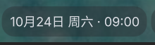
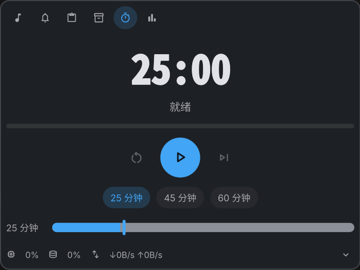

# Notchy for Linux

Mac 灵动岛风格的 Linux 顶栏插件，基于 **Quickshell** 与 **DankMaterialShell（DMS）**。

<p align="center">
  
</p>

<p align="center">
  
</p>

## 功能

- 顶栏药丸：时钟、媒体频谱与曲名、番茄钟、通知和音量瞬态镜像。
- 六标签页弹层：媒体、通知、剪贴板、文件暂存架、专注和 AI 额度用量。
- 视觉体验：内容淡入淡出、轻微位移动画、弹层展开动画、延迟 Tooltip 和统一状态反馈。
- 减少动画：支持插件独立设置，并遵循 DMS 全局动画设置。
- 系统集成：MPRIS、PipeWire、通知、剪贴板、日历、cava 和系统监控。
- 自动化测试：番茄钟、用量请求、暂存架、标签页、日历和视觉结构回归。

## 文档

- [安装、交互、IPC 与设置说明](plugin/README.md)
- [项目方案与实施记录](PLAN.md)
- [自动测试与人工回归清单](tests/README.md)

## 测试

```bash
bash tests/run-tests.sh
```
